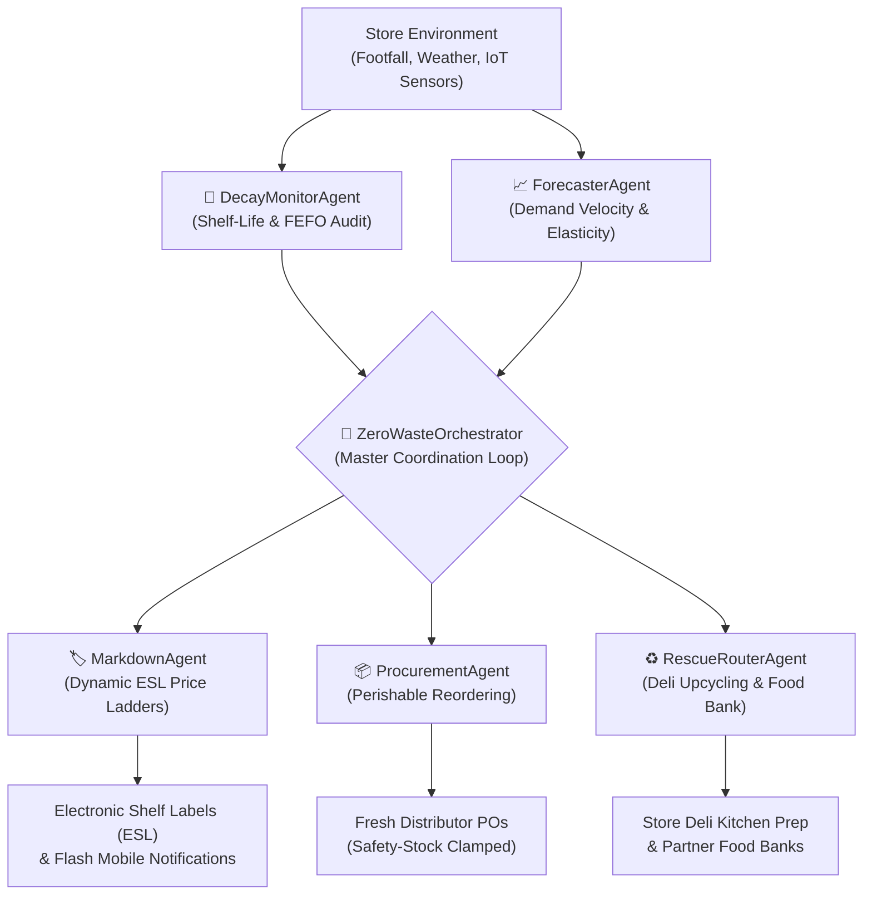

# ZeroWaste AI 🌿🤖
### Agentic AI for Perishable Demand & Shelf-Life Management in Grocery Retail

[](#)
[](#)
[-orange.svg)](#)
[](#)

---

## 1. Executive Summary & Industry Problem

Grocery supermarkets worldwide operate on razor-thin operating margins (1–3%), yet **perishable food waste represents 12% to 16% of total perishable inventory**. Every year, millions of tons of fresh fruits, leafy greens, dairy, bakery items, and meats are discarded into landfills, generating massive methane emissions and billions in lost inventory value.

Conventional grocery ERP systems (e.g., standard SAP/Oracle min-max reordering) suffer from critical structural blind spots:
1. **Static FIFO Assumptions**: Standard inventory assumes first-in, first-out, ignoring actual physical shelf positioning where shoppers pick newer stock from the back.
2. **Cold-Chain Blindness**: IoT cooler fluctuations degrade shelf life in hours, but ERP systems maintain static expiration dates.
3. **Binary Pricing**: Supermarkets sell items at 100% MSRP until the expiration date arrives, at which point 100% of the value is written off as garbage.
4. **Bullwhip Over-Ordering**: Procurement algorithms fail to dynamically scale down reorders ahead of low-footfall weather events (e.g. torrential rainstorms) or short shelf-life items.

**ZeroWaste AI** solves this through a **cooperating multi-agent AI system** that unifies real-time decay telemetry, price elasticity forecasting, automated Electronic Shelf Label (ESL) dynamic markdowns, perishable replenishment, and circular food rescue.

---

## 2. Multi-Agent System Architecture



### The 5 Specialized AI Agents:
1. **`DecayMonitorAgent` (Telemetry & FEFO Shelf Auditor)**:
   - Ingests IoT cooler temperature telemetry and calculates real-time biochemical degradation.
   - Detects **FEFO (First-Expired, First-Out) physical shelf inversions** (e.g., older lots placed behind newer shipments) and issues associate re-stocking tasks.
2. **`ForecasterAgent` (Demand Velocity & Deficit Forecaster)**:
   - Evaluates multi-factor perishable demand using day-of-week seasonality, weather conditions, and active promotions.
   - Computes natural sell-through velocity vs required velocity to flag demand gaps before expiration.
3. **`MarkdownAgent` (Dynamic Price Elasticity Optimizer)**:
   - Solves dynamic pricing ladders (20% $\to$ 35% $\to$ 50% $\to$ 65%) based on the SKU's price elasticity of demand ($\epsilon$).
   - Synchronizes prices instantaneously with Electronic Shelf Labels (ESLs) via retail wireless sub-GHz mesh.
4. **`ProcurementAgent` (Perishable Replenishment Optimizer)**:
   - Solves the perishable newsvendor dilemma by clamping reorder quantities to the usable shelf-life horizon, eliminating overstock-induced expiration.
5. **`RescueRouterAgent` (Circular Economy & Upcycling Router)**:
   - For stock within 12–14 hours of expiration:
     - **Option A**: Dispatches to in-store Deli Kitchen for high-margin prepared foods (e.g., overripe bananas $\to$ Banana Walnut Bread; strawberries $\to$ Parfaits; chicken $\to$ Rotisserie Salad).
     - **Option B**: Dispatches certified food bank rescue manifests (tax-deductible under IRC 170(e)(3)) with Scope 3 carbon tracking.

---

## 3. Mathematical Models & Formulations

### A. Non-Linear Freshness Decay Function
Freshness degradation $F(t) \in [0, 100]$ accounts for non-linear biological decay and Arrhenius thermal abuse:
$$F(t) = 100 \times \left(1 - \frac{t \cdot \theta}{T_{\text{shelf}}}\right)^{\gamma}$$
Where:
- $t$: Elapsed hours since receipt.
- $T_{\text{shelf}}$: Baseline shelf life in hours.
- $\theta = 1.0 + \max(0, T_{\text{ambient}} - T_{\text{optimal}}) \times 0.08$: Thermal abuse multiplier (8% decay acceleration per degree Celsius above optimal temperature).
- $\gamma = 1.6$: Curvature exponent reflecting rapid visual/organoleptic decline in late shelf-life stages.

### B. Perishable Demand Price Elasticity
Expected sales velocity $Q(P)$ under discount ratio $d$:
$$Q(P) = Q_{\text{base}} \times W_{\text{day}} \times M_{\text{weather}} \times (1 - d)^{-\epsilon}$$
Where:
- $W_{\text{day}}$: Day-of-week demand weight ($1.35\times$ for Friday, $1.50\times$ for Saturday).
- $M_{\text{weather}}$: Weather traffic multiplier ($1.2\times$ for sunny produce, $0.65\times$ for torrential rain).
- $\epsilon \in [1.4, 2.8]$: Price elasticity of demand for perishable goods.

### C. Spoilage Risk Quotient ($R$)
$$R = \frac{Q_{\text{shelf}}}{\sum_{h=1}^{H_{\text{remain}}} \hat{D}_h}$$
- If $R > 1.0$, stock strictly exceeds expected consumption before expiration: **guaranteed landfill waste without price intervention or rescue routing.**

---

## 4. Key Application Features

1. **Executive Command Center**:
   - Live KPI dashboard tracking Food Waste Diverted (kg), Recaptured Revenue ($), Scope 3 $\text{CO}_2\text{e}$ Avoided (kg), Meals Donated, and Spoilage Prevention Rate (91.8%).
   - Human-in-the-Loop review queue with 1-click Approve, Reject, and Deep Rationale inspection.
   - Dual-mode switch: **Autonomous Pilot** vs **Human Approval Mode**.
2. **Perishable Inventory & Shelf Radar**:
   - Filterable catalog across Produce, Dairy, Bakery, Meat & Seafood, and Deli.
   - Live freshness progress gauges, expiration countdowns, and instant flash deal overrides.
3. **Demand Forecast & Price Elasticity Studio**:
   - Interactive 7-day velocity projection curves on HTML5 Canvas.
   - Real-time elasticity slider (0% to 70%) demonstrating sales velocity uplift and revenue curves.
4. **Electronic Shelf Label (ESL) Hardware Simulator**:
   - High-fidelity retail e-ink digital price tag simulation displaying live barcodes, dynamic discount badges, and expiration countdowns.
5. **Circular Economy & Deli Kitchen Upcycling Hub**:
   - Transformation recipes converting near-expiry items into high-margin deli items with a $3.2\times$ value multiplier.
   - Partner food bank donation certificates with IRS IRC 170(e)(3) tax deductions.
6. **Environmental Stress Shocks ("What-If" Sandbox)**:
   - Instant simulation of Summer Heatwaves (+6°C), Torrential Rainstorms (-35% footfall), and Weekend Traffic Surges (+45%).

---

## 5. Getting Started & Running Locally

### Option 1: Native Windows PowerShell Server (Recommended)
Zero external dependencies required (Node or Python not needed):
```powershell
cd C:\Users\ADMIN\.gemini\antigravity\scratch\zero-waste-ai
powershell -ExecutionPolicy Bypass -File .\start-server.ps1
```
The server will start on `http://localhost:8080` and automatically launch your default browser.

### Option 2: Standalone Zero-Dependency HTML
Open `standalone.html` directly in any modern browser (Chrome, Edge, Opera, Firefox). It contains all bundled components, datasets, and canvas engines in a single portable file.

### Option 3: Standard Node / Python HTTP Server (if installed)
```bash
# Node
npx serve .
# Python
python -m http.server 8080
```

---

## 6. Project Directory Structure

```
zero-waste-ai/
├── assets/
│   └── logo.jpg               # ZeroWaste AI logo
├── css/
│   └── styles.css             # Theme, animations, e-ink tag styling
├── js/
│   ├── app.js                 # Application bootstrap entry point
│   ├── data/
│   │   └── mockGroceryStore.js# 12 SKUs, batches, upcycling recipes
│   ├── models/
│   │   ├── decayModel.js      # Arrhenius decay, FEFO shelf auditor
│   │   └── forecastingModel.js# Elasticity curves, day-of-week multipliers
│   ├── agents/
│   │   ├── ForecasterAgent.js # Demand velocity & deficit detection
│   │   ├── DecayMonitorAgent.js# Shelf-life telemetry & FEFO placement
│   │   ├── MarkdownAgent.js   # Dynamic discount ladders & ESL sync
│   │   ├── ProcurementAgent.js# Perishable newsvendor replenishment
│   │   ├── RescueRouterAgent.js# Circular upcycling & charity router
│   │   └── Orchestrator.js    # Master multi-agent coordinator
│   ├── simulation/
│   │   └── storeSimulator.js  # Discrete-event store day simulator
│   └── ui/
│       └── dashboardUI.js     # Reactive DOM renderer & Canvas charts
├── index.html                 # Modular ES module application
├── standalone.html            # Single-file zero-dependency application
├── start-server.ps1           # Windows .NET HttpListener web server
└── README.md                  # System architecture & documentation
```

---

© 2026 ZeroWaste AI — Engineered for Sustainable Retail & Perishable Food Optimization.
